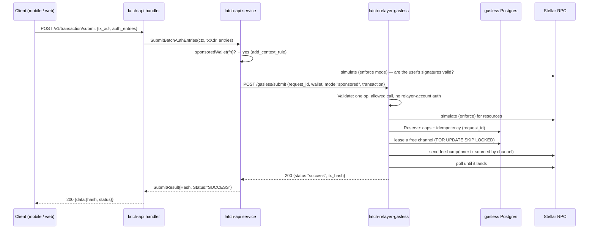

# How a sponsored transaction flows: user → latch-api → latch-relayer-gasless → Stellar → back

Walkthrough of issue #110's fix as of PR 3K1-Labs/latch-api#117 (Phase A) and
3K1-Labs/latch-relayer#68 (fee pricing), 2026-10-17. Line numbers are from those branches.

## TL;DR



The user's wallet only signs **Soroban auth entries**. Who sources the transaction and who pays
its fee is invisible to the user — which is why we could swap the bundler for channel accounts
without changing what clients sign.

---

## 1. The problem we fixed

Before, every path did this (old `submitWithBundler`, `Deploy`, …):

```go
bundlerG := s.bundler.PublicKey()
seq, err := s.soroban.GetAccountLedgerSequence(ctx, s.rpcURL, bundlerG) // read seq N
// … build tx at N+1, sign with bundler, send
```

Two requests arriving together both read `N`, both build `N+1`; Stellar accepts the first and
rejects the second with **`tx_bad_seq`**. One account = one pending transaction at a time ≈ one
tx per ledger (~5 s).

**Fix:** latch-relayer-gasless owns a *pool* of channel accounts. Each in-flight transaction leases
its own channel (its own sequence number), and the **funder** pays the fee via a **fee-bump** — a
fee-bump doesn't consume the funder's sequence, so the funder is never the bottleneck either.
Throughput ≈ `CHANNEL_COUNT` per ledger (3 today; raise with `make channels`).

---

## 2. Walkthrough: a mobile user installs a send rule (sponsored)

### 2.1 Route — `cmd/server/router.go`

```go
// router.go:50 — one client per deployment, built from env
gaslessSvc := service.NewGaslessService(cfg.GaslessURL, cfg.GaslessAPIKey, cfg.GaslessTimeout)
if !gaslessSvc.Configured() {
    slog.Warn("GASLESS_URL not configured — wallet creation, setup rules and signer changes will answer 503")
}
// …injected into both services (constructor DI, router.go:135 and :140)
webapp.NewTransactionService(…, cfg.WebAppCounterContractAddress, gaslessSvc)

// router.go:363 — the mobile submit route: JWT auth + per-user rate limit
transaction.POST("/submit", transactionRelayLimiter, transactionRelayHandler.Submit)
```

### 2.2 Handler — `internal/handler/transaction_relay.go`

The handler only parses, validates, calls the service, and maps errors (layer discipline):

```go
// transaction_relay.go:153
result, err := h.txSvc.SubmitBatchAuthEntries(c.Request.Context(), req.TxXdr, entries)
if err != nil {
    if failGasless(c, err) {   // new: 503 for outages/pending, 429 for caps
        return
    }
    // existing: anything else is the caller's tx being invalid → 400
    httpx.Fail(c, http.StatusBadRequest, httpx.ErrValidation, "transaction was rejected: "+sanitizeSubmitError(err))
    return
}
```

`failGasless` lives in `internal/handler/gasless_errors.go` (and a webapp twin in
`internal/handler/webapp/gasless_errors.go` using the webapp error envelope):

```go
// gasless_errors.go:20
switch {
case errors.Is(err, service.ErrGaslessLimited):
    httpx.Fail(c, http.StatusTooManyRequests, httpx.ErrRateLimited, "too many requests, please try again later")
case errors.Is(err, service.ErrGaslessNotConfigured),
    errors.Is(err, service.ErrGaslessUnavailable),
    errors.Is(err, service.ErrGaslessPending):
    httpx.Fail(c, http.StatusServiceUnavailable, httpx.ErrBadGateway, "transaction service is temporarily unavailable, please retry")
default:
    return false // not a gasless failure: caller's own mapping applies
}
```

*Why `errors.Is`:* every layer wraps with `fmt.Errorf("…: %w", err)`, so the sentinel survives
any amount of context being added on the way up.

### 2.3 Service decides: sponsored or bundler — `internal/service/webapp/transaction_batch.go`

```go
// A single sponsored call goes to latch-relayer-gasless; a batch (device
// pairing) stays with the bundler until the gasless service accepts more
// than one operation.
var wallet string
sponsored := false
if len(hostFunctions) == 1 {
    wallet, sponsored = sponsoredWallet(hostFunctions[0])
}
var seq int64
if !sponsored { // only a tx the bundler signs needs its sequence
    if seq, err = s.soroban.GetAccountLedgerSequence(ctx, s.rpcURL, bundlerG); err != nil { … }
}
// … build + simulate in ENFORCE mode (validates the user's signatures) …
if sim.Error != "" {
    return SubmitResult{}, fmt.Errorf("auth validation failed: %s", sim.Error)
}
if sponsored {
    return submitSponsored(ctx, s.gasless, wallet, hostFunctions[0], entries)
}
// … else: old bundler path (sign, send, poll) …
```

The web path is the same shape in `submitWithBundler` (`transaction_service.go:896`, decision at
`:909`, hand-off at `:956`).

**Why keep latch-api's own simulation (decision 3)?** A bad signature fails *here* with a clear
"auth validation failed" 400, before the relayer reserves budget or leases a channel. Cost: one
extra RPC simulate (~200 ms).

### 2.4 What counts as sponsored — `internal/service/webapp/gasless.go`

```go
// gasless.go:27 — must match the gasless deployment's SPONSORED_CALLS
var sponsoredWalletFunctions = map[string]bool{
    "add_context_rule":    true,
    "add_signer":          true,
    "remove_context_rule": true,
}

// gasless.go:35 — the invoked contract IS the wallet for these calls
func sponsoredWallet(fn xdr.HostFunction) (string, bool) {
    if fn.Type != xdr.HostFunctionTypeHostFunctionTypeInvokeContract || fn.InvokeContract == nil {
        return "", false
    }
    if !sponsoredWalletFunctions[string(fn.InvokeContract.FunctionName)] {
        return "", false
    }
    wallet, err := fn.InvokeContract.ContractAddress.String()
    …
}
```

If this list and the relayer's `SPONSORED_CALLS` drift apart, the relayer refuses with
`403 not_sponsorable` → `ErrGaslessRefused` → the user sees a 400. **Ops rule:** change both
together.

### 2.5 Hand-off — `submitSponsored` (`gasless.go:74`)

```go
reqID, err := gaslessRequestID(fn, entries) // sha256(host fn ‖ auth entries) → "latch_<40 hex>"

tx, err := txnbuild.NewTransaction(txnbuild.TransactionParams{
    SourceAccount: &txnbuild.SimpleAccount{AccountID: simDummySourceAccount, Sequence: 0}, // placeholder
    Operations: []txnbuild.Operation{&txnbuild.InvokeHostFunction{
        HostFunction: fn, Auth: entries, SourceAccount: simDummySourceAccount,
    }},
    …
})
envelope, _ := tx.Base64() // unsigned: the relayer re-sources it onto a channel

rec, err := gasless.Submit(ctx, service.GaslessSubmission{
    RequestID: reqID, Wallet: wallet, Mode: service.GaslessModeSponsored, Transaction: envelope,
})
if errors.Is(err, service.ErrGaslessPending) && rec.TxHash != "" {
    return SubmitResult{Hash: rec.TxHash, Status: service.RPCStatusPending}, nil // sent, not confirmed yet
}
```

**Idempotency, line by line:** the id is derived from *what* is submitted, not random. A mobile
retry after a timeout sends byte-identical host function + auth entries → same id → the relayer
answers with the first submission's record instead of paying again. (Different auth entries — e.g.
a fresh nonce — are a genuinely different request and get a different id.)

### 2.6 HTTP client — `internal/service/gasless_service.go`

```go
// gasless_service.go:123
func (s *GaslessService) Submit(ctx context.Context, sub GaslessSubmission) (GaslessRecord, error) {
    ctx, cancel := context.WithTimeout(ctx, s.budget) // GASLESS_TIMEOUT_SEC, default 25s
    defer cancel()
    rec, err := s.call(ctx, http.MethodPost, "/gasless/submit", body)
    …
    for !isGaslessFinal(rec.Status) {                 // :139 — 202 means "still going"
        select {
        case <-ctx.Done():
            return rec, fmt.Errorf("%w: request %s is %s", ErrGaslessPending, sub.RequestID, rec.Status)
        case <-time.After(s.pollInterval):            // 1s
        }
        rec, err = s.call(ctx, http.MethodGet, "/gasless/requests/"+url.PathEscape(sub.RequestID), nil)
    }
    switch rec.Status {
    case GaslessStatusSuccess: return rec, nil
    case GaslessStatusFailed:  return rec, ErrGaslessFailed (wrapped)
    default:                   return rec, ErrGaslessUnavailable (wrapped) // "rejected": nothing charged
    }
}
```

`call` (`:178`) classifies non-2xx answers: 429 → `ErrGaslessLimited`; 401 or 5xx →
`ErrGaslessUnavailable`; any other 4xx → `ErrGaslessRefused`.

**Budget math:** global request timeout 30 s > gasless budget 25 s > relayer's own sync wait 20 s.
If the relayer hasn't finished in 20 s it answers 202 and we keep polling until 25 s; past that
the user gets 503 and a retry is safe (same request id).

### 2.7 Relayer receives it — latch-relayer `internal/gasless/api/submit.go:104`

```go
p, existing, err := s.Sponsor.Prepare(r.Context(), req) // validate, simulate, reserve
…
if existing { writeRecord(w, p.Record); return }          // idempotent repeat
done := make(chan sponsor.Record, 1)
s.Work.Go(func(ctx context.Context) { done <- s.Sponsor.Run(ctx, p) }) // send in background
select {
case rec := <-done:                 writeRecord(w, rec)      // 200 final
case <-time.After(s.SyncWait):      writeRecord(w, p.Record) // 202 pending; caller polls
case <-r.Context().Done():          // caller left; the submission carries on
}
```

### 2.8 Validate — `internal/gasless/sponsor/request.go:76`

Defence in depth for the one thing the relayer owns, the funder's XLM:
- exactly **one** `InvokeHostFunction` op calling a contract (why device-pairing batches can't go here yet);
- **no source-account credentials** and no auth entry claiming a relayer account (executor, funder, channels);
- sponsored mode: `Policy.Allows` (`:209`) — the call must be in `SPONSORED_CALLS`, where `wallet:` means "the request's wallet".

### 2.9 Prepare — `internal/gasless/sponsor/submitter.go:118`

1. simulate in enforce mode → resources and fee;
2. `Store.Reserve` (`store.go:141`) under a Postgres lock: idempotency on `request_id`, then
   `checkCaps` (`store.go:196`) — per-wallet tx count, per-wallet XLM, daily XLM budget
   (`SPONSOR_MAX_TX_PER_WALLET=20`, `SPONSOR_MAX_XLM_PER_WALLET=5`, `SPONSOR_MAX_XLM_PER_DAY=100`).

### 2.10 Run — lease a channel, fee-bump, send (`submitter.go:412` / `:444`)

Lease (`channels/pool.go:128`) — the line that makes concurrency safe across any number of
relayer instances:

```sql
SELECT id … FROM channel_accounts
WHERE status = 'active' AND (lease_token IS NULL OR lease_expires_at < NOW())
ORDER BY last_used_at NULLS FIRST, hd_index
LIMIT 1
FOR UPDATE SKIP LOCKED   -- two concurrent acquirers never get the same channel
```

Seal (`submitter.go:~530`):

```go
env, _ := s.envelope(channelAddr, seq, p.call, &sd, inclusion, validUntil) // inner: source = channel, its own seq
inner, _ = inner.Sign(s.Passphrase, channel)                                // channel signs the inner tx
outer, _ := feebump.AtInnerRate(inner.ToXDR(), s.Funder.Address())          // funder wraps it in a fee-bump
outer, _ = signer.SignFeeBump(ctx, s.Funder, outer, s.Passphrase)           // funder signs → pays the fee
```

Then send, poll, release the channel with its consumed sequence. If the channel's sequence was
stale it retries on a fresh lease (up to 3×); if every channel is busy it finishes `rejected /
channels_busy` (nothing charged) → latch-api `ErrGaslessUnavailable` → user 503.

### 2.11 Back up the stack

| Where | What it returns |
|---|---|
| relayer | `200 {"status":"success","tx_hash":"…"}` |
| `GaslessService.Submit` | `GaslessRecord{Status:"success", TxHash}` |
| `submitSponsored` | `SubmitResult{Hash, Status:"SUCCESS"}` |
| `SubmitBatchAuthEntries` | same, unchanged type |
| handler | audit log `transaction_relayed`, push notification, `200 {data:{hash,status}}` |

---

## 3. Variant: wallet creation — `SmartAccountService.Deploy` (`smartaccount_service.go:189`)

Every creation path (passkey `DeployForCredential`, `DeployByKeyData`, delegated, ed25519,
multisig accounts/drafts) funnels into this one function:

```go
deployed, err := s.IsDeployed(ctx, predictedAddress) // already there? return early (idempotent)
…
createFn := invokeContractHostFunction(factoryContractID, "create_account", params)
result, err := submitSponsored(ctx, s.gasless, predictedAddress, createFn, nil) // :204, no auth entries
if result.Status != service.RPCStatusSuccess {
    return "", false, fmt.Errorf("create_account %s: %w", result.Hash, service.ErrGaslessPending)
}
// read it back from latch-api's own RPC (up to 30 × 1s, within the request deadline):
// confirms it landed and returns the address create_account produced
actualAddress, err := s.pollDeployResult(ctx, result.Hash)
if actualAddress != predictedAddress {
    return "", false, fmt.Errorf("deterministic address mismatch: predicted=%s actual=%s", predictedAddress, actualAddress)
}
```

- `wallet` for the relayer's caps is the **predicted** C-address (the account doesn't exist yet).
- No latch-api simulation here: `create_account` has no user signatures to check; the relayer simulates anyway.
- Why poll: the relayer and latch-api read **different RPC nodes**, so a transaction the relayer saw land can be briefly `NOT_FOUND` here. The hash is the relayer's **fee-bump** hash; `getTransaction` on it returns the inner execution's meta, which is where the returned address comes from.
- Not visible before the deadline → `ErrGaslessPending` → 503: the client retries → `IsDeployed` short-circuits if the first attempt landed meanwhile.
- The validity window of latch-api's envelope doesn't matter here: the relayer builds its own channel transaction with `txValidity = 2 * time.Minute` (latch-relayer `internal/gasless/sponsor/submitter.go:35`).

---

## 4. Phase B (user-paid sends and swaps) and what is still on the bundler

Sends and swaps are user-paid (phase B, `internal/service/webapp/gasless_forward.go`):
`BuildSend` / `BuildSwap` call `planForward` (fee-token config → simulate the plain action →
quote XLM then USDC → pick the first token whose balance covers max fee + spend), wrap the call in
`forward()`, drop the executor's recorded entry, give each context its own rule id and embed them
in the returned entry. Submit sees a `forward()` on our FeeForwarder (`userPaidWallet`) and calls
`submitForward` → `/gasless/submit` mode `forward`. Multisig execute and device pairing still take
the old bundler path — the race still exists there until their own phases.

Phase B wraps the call in `FeeForwarder.forward(fee_token, fee_amount, max_fee_amount,
expiration_ledger, target_contract, target_fn, target_args, user, relayer)`. Proven on mainnet
(2026-10-16) — the wallet signs one tree, each context against its own rule:

```
CCQXTY…HSTA.forward                      → rule 0 (Default)
CCQXTY…HSTA.forward > XLM SAC.approve    → rule 1 (XLM CallContract rule)
CCQXTY…HSTA.forward > XLM SAC.transfer   → rule 1
```

Fee pricing after latch-relayer#68: priced from the **enforce-mode** simulation, × (1 +
`FEE_MARGIN_BPS`=10%). Last test send: network 60,211 stroops, user 79,805 (1.33×; the rest is the
network's refund of unused reserved fee, which goes to the funder). Collected fees sit in
FeeForwarder until the manager sweeps them to the funder (`FORWARDER_SWEEP_ALERT=5`).

---

## 5. Errors, end to end

| Relayer says | latch-api sentinel | Client sees | Retry? |
|---|---|---|---|
| 200 `success` | — | 200 `{hash,status:"SUCCESS"}` | — |
| 202 / `pending` / `unconfirmed` after 25 s, has hash | `ErrGaslessPending` → `SubmitResult{PENDING}` | 200 `{status:"PENDING"}` | poll by hash |
| same, no hash yet | `ErrGaslessPending` | **503** | yes, same request id |
| `rejected` (`channels_busy`, stale seqs) | `ErrGaslessUnavailable` | **503** | yes |
| 503 `sponsorship_unavailable` (funder below floor) | `ErrGaslessUnavailable` | **503** | after top-up |
| 401 (our key wrong) / 5xx / timeout | `ErrGaslessUnavailable` | **503** | ops fix |
| 429 `wallet_cap_reached` / `daily_budget_reached` | `ErrGaslessLimited` | **429** (`RATE_LIMITED` mobile, `sponsorship_limit_reached` web) | later |
| 400 / 403 / 409 / 422 | `ErrGaslessRefused` | 400 (existing mapping) | no |
| final `failed` | `ErrGaslessFailed` | 400 / 500 (existing mapping) | no |
| `GASLESS_URL` unset | `ErrGaslessNotConfigured` | **503** | ops fix |

---

## 6. Operating it

**Config**
- latch-api (`latch-api-4cvn`): `GASLESS_URL`, `GASLESS_API_KEY` (= gasless `RELAYER_API_KEY`), `GASLESS_TIMEOUT_SEC`.
- gasless (`latch-relayer-gasless`): `SPONSORED_CALLS`, caps, `CHANNEL_COUNT`, `FEE_MARGIN_BPS`, `FORWARDER_SWEEP_ALERT`; health check path `/health`.

**Where money moves**
- Funder `GANBMAQJ…LSTN` pays every fee-bump; sponsorship pauses below `FUNDER_MIN_XLM` (5).
- Channels need only their base reserve; they never pay fees.
- User-paid fees accumulate in FeeForwarder; the manager (deployer key) sweeps them back.

**What breaks, and how you'd see it**
| Symptom | Likely cause | Where to look |
|---|---|---|
| All creations 503 | `GASLESS_URL`/key unset or wrong, gasless down | latch-api log `gasless service unavailable`; gasless `/health` |
| 503 bursts under load | all channels leased | `/gasless/status` → `channels.leased`; raise `CHANNEL_COUNT` |
| 503 "sponsorship_unavailable" | funder below floor | `/gasless/status` → `funder_balance_stroops`; top up |
| 429 for one user | per-wallet cap | gasless `sponsored_transactions` for that wallet |
| 429 for everyone | daily budget hit | `SPONSOR_MAX_XLM_PER_DAY` |
| a setup call 400 `not_sponsorable` | latch-api list ≠ `SPONSORED_CALLS` | `internal/service/webapp/gasless.go` vs Render env |

---

## 7. File index

**latch-api**
| File | Role |
|---|---|
| `cmd/server/router.go` | builds `GaslessService`, injects it |
| `internal/config/config.go` | `GASLESS_*` env |
| `internal/service/gasless_service.go` | HTTP client, polling, error classification |
| `internal/service/webapp/gasless.go` | sponsored-call list, request id, `submitSponsored` |
| `internal/service/webapp/transaction_service.go` | `submitWithBundler`: web submits, decision + hand-off |
| `internal/service/webapp/transaction_batch.go` | `SubmitBatchAuthEntries`: mobile submits |
| `internal/service/webapp/smartaccount_service.go` | `Deploy`: every wallet creation |
| `internal/handler/gasless_errors.go`, `internal/handler/webapp/gasless_errors.go` | 503 / 429 mapping |

**latch-relayer** (`cmd/gasless`)
| File | Role |
|---|---|
| `internal/gasless/api/submit.go` | `/gasless/submit`, `/gasless/requests/{id}`, `/gasless/quote` |
| `internal/gasless/sponsor/request.go` | `Validate`, `Policy` (`SPONSORED_CALLS`) |
| `internal/gasless/sponsor/submitter.go` | `Prepare`, `priceForward`, `Run`, `attempt`, `seal` (fee-bump) |
| `internal/gasless/sponsor/store.go` | records, idempotency, `checkCaps` |
| `internal/gasless/channels/pool.go` | channel leases (`FOR UPDATE SKIP LOCKED`) |
| `internal/gasless/balance/monitor.go` | funder/channel balances, FeeForwarder sweep alert |
